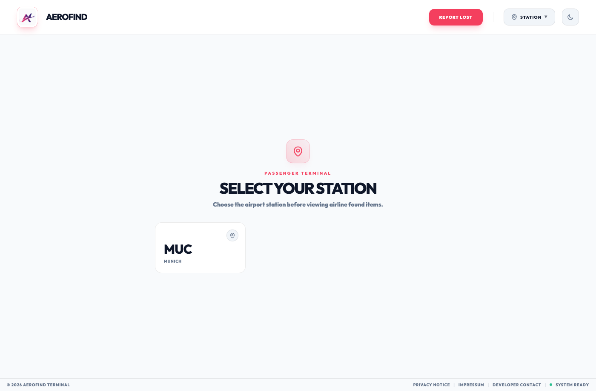
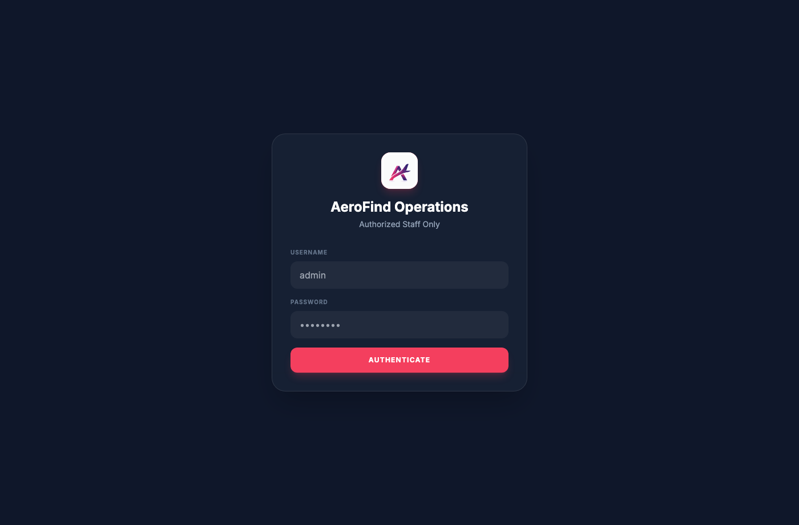
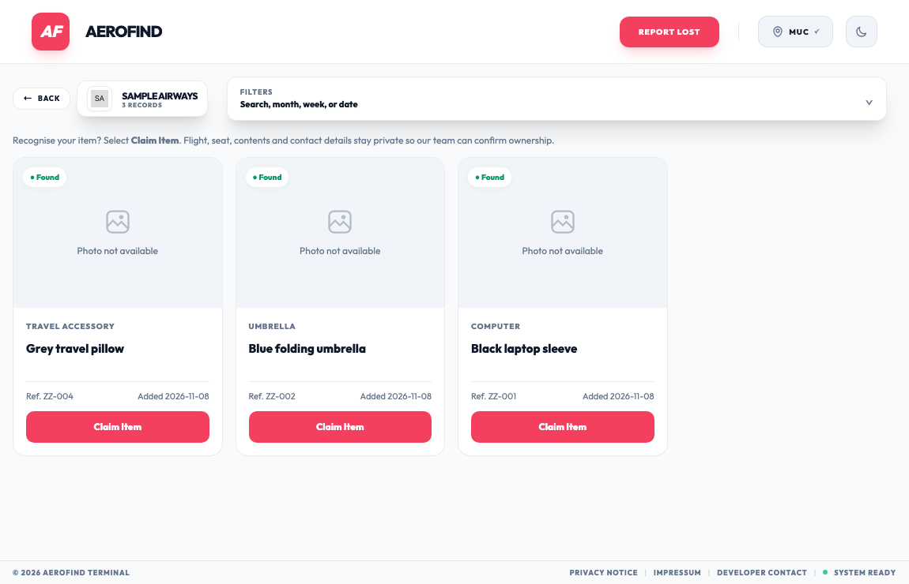
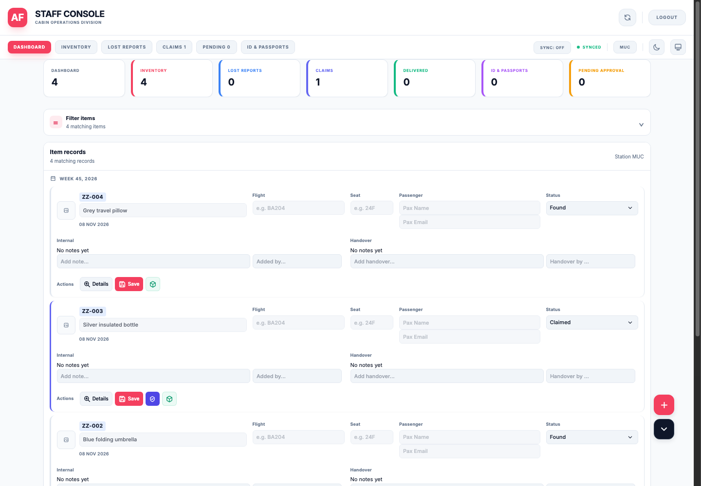

# AeroFind Cabin Recovery Portal

AeroFind is a hosted lost-and-found system for items left on aircraft. Passengers can search listings and submit claims or lost reports. Airport teams use a separate staff console to manage inventory, verify claims, and record handovers.

[Passenger portal](https://cabin.aerofind.online/) · [Staff sign-in](https://cabin.aerofind.online/staff)

## Core capabilities

- **Passenger portal** lets passengers choose an airport station and airline, browse eligible found items, and submit a claim or lost report without creating an account.
- **Staff console** lets station teams register found items, review reports and possible matches, and track each case through collection or closure.
- **Station access** scopes staff and supervisor accounts to their assigned airport. Administrators manage stations and portal settings.
- **Notifications** can send passenger updates when email is configured. Staff can also estimate optional handling and storage charges.

## Technical overview

| Component | How it works |
| --- | --- |
| Web application | PHP serves the passenger portal and the authenticated staff console over HTTPS. Apache handles routing and web access rules. |
| Data storage | Each station has its own SQLite database for inventory, reports, and related activity. |
| Passenger requests | The public interface limits which actions can be performed. Public listings show identifying details for the item. Staff review passenger contact and journey information privately. |
| Staff access | The staff console uses authenticated sessions and role-based permissions. |
| Email | Administrators can configure outbound notifications using SMTP or PHP mail. |

## Accounts and sign-in

The hosted portal is free to use. Passengers can open the passenger portal directly. Staff, supervisors, and administrators use the [staff sign-in page](https://cabin.aerofind.online/staff).

| Role | Demo username | Scope |
| --- | --- | --- |
| Staff | `demo-staff` | Station inventory, reports, claims, and handovers. |
| Supervisor | `demo-supervisor` | Station operations with additional record-management permissions. |
| Administrator | `demo-admin` | Station configuration, account settings, and system administration. |

Enter the username for the role you’re reviewing and use the password provided privately by the portal owner. For regular staff access, include your airport station and role when requesting an account.

## Example workflow

1. A staff member registers a found item and assigns an inventory reference.
2. The passenger finds the listing and submits a claim with verification details. If the item is missing from the listings, the passenger can submit a lost report.
3. Staff review the claim or possible match, decide whether to approve it, and record the handover when the item is collected.

## Screenshots

### Live website

### Demo workflows

These screenshots use fictional records.

